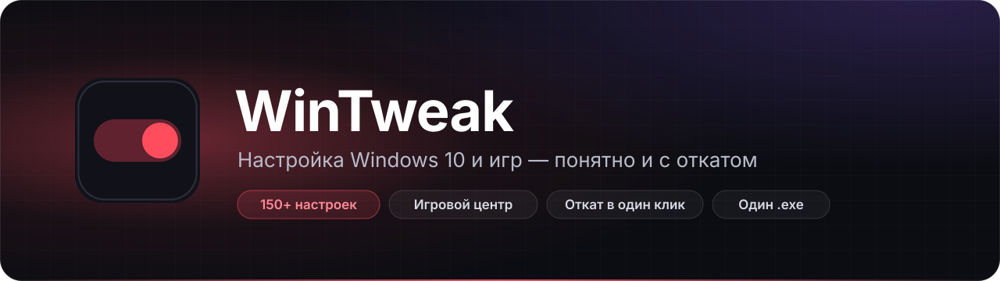

<p align="center">
  
</p>

<p align="center">
  <a href="https://github.com/rentice1337/WinTweaker/releases/latest"></a>
  <a href="https://github.com/rentice1337/WinTweaker/releases"></a>
  <a href="https://github.com/rentice1337/WinTweaker/actions/workflows/build.yml"></a>
  
  
  <a href="LICENSE"></a>
</p>

<h3 align="center">
  <a href="https://github.com/rentice1337/WinTweaker/releases/latest/download/WinTweaker.exe">⬇ Скачать WinTweaker.exe</a>
</h3>
<p align="center">
  Один файл, ничего устанавливать не нужно · <a href="https://github.com/rentice1337/WinTweaker/releases">Все версии</a> · <a href="CHANGELOG.md">Что нового</a>
</p>

---

**WinTweak** — бесплатная программа для настройки Windows 10 и игр от [rentice1337](https://github.com/rentice1337).
В ней больше 150 настроек: приватность, производительность, интерфейс, службы, сеть. У каждой есть понятное объяснение и точный список того, что будет изменено.
Ничего не меняется, пока вы не нажмёте «Применить». Любое изменение можно отменить из «Истории».

## Как это работает

1. **Отметьте** нужное переключателями или выберите готовый пресет: «Рекомендуемый», «Игровой», «Приватность», «Слабый ПК».
2. **Посмотрите**, что изменится: внизу появится панель «Отмечено N изменений», а у каждой настройки видны точные ключи реестра и команды.
3. **Примените**. Перед применением создаётся точка восстановления Windows, а сеанс записывается в «Историю», откуда его можно откатить целиком.

## Возможности

### Настройка Windows
- **Объяснения и метки** у каждой настройки: «безопасно», «нужна перезагрузка», «для опытных», «разовое действие».
- **Не только вкл/выкл:** ползунки и варианты — расположение панели задач, скорость мыши и колеса, повтор клавиш, таймауты экрана и сна, отсрочка обновлений, активные часы.
- **Точный откат** любого сеанса: реестр восстанавливается побайтно, службы — к прежнему типу запуска, DNS и схема питания — к прежним значениям.
- **Сторож настроек.** Крупные обновления Windows часто откатывают твики. WinTweak замечает это и возвращает настройки одной кнопкой.
- **Оценка системы 0–100** и советы под ваше железо: SSD или HDD, ноутбук или ПК, видеокарта, объём памяти, место на диске, автозагрузка.
- **Контекстное меню Проводника:** добавить «Копировать путь», «Открыть PowerShell здесь», «Стать владельцем»; убрать лишние пункты.
- **Программы:** популярные программы ставятся через winget — отметили и нажали «Установить». Также есть менеджер автозагрузки и служб.
- **Свои наборы и профиль кодом:** сохраните отметки под именем или отправьте другу строку `WT1-…` — он получит те же настройки.
- **Палитра команд Ctrl+K:** любая настройка, раздел или действие с клавиатуры.

### Игровой центр
- **Мои игры.** Находит игры в Steam, Epic Games, EA app, Battle.net, Riot и BSG; можно добавить любой exe. Плитки с обложками.
  В режиме «Изменить» игры можно скрыть, закрепить, переставить, переименовать или поставить свою обложку. Одна игра из нескольких лаунчеров показывается одной плиткой.
- **Пресеты для 18 игр** (CS2, VALORANT, Apex Legends, Fortnite, Dota 2, Escape from Tarkov и другие) и общий пресет для любой игры:
  высокий приоритет процессора, мощная видеокарта, отключение оптимизации во весь экран, приоритет трафика, а также советы по настройкам в самой игре. Файлы игр не изменяются.
- **Игровой режим «Не беспокоить»** включается сам при запуске игры: нет уведомлений, загрузки обновлений стоят на паузе, включается высокая производительность. После игры всё возвращается как было — даже после сбоя.
- **Отчёт после матча:** средний FPS, 1% low и график кадров, пинг и потери. Видно, где были скачки: дома или у провайдера.
  FPS считается через события Windows (ETW), в игру ничего не внедряется.
- **Пинг до серверов** Valve, AWS или своего адреса и **трассировка** с задержкой на каждом узле.
- **Готовность к игре:** проверка питания, Game DVR, фоновой нагрузки, памяти, частоты монитора и драйвера видеокарты.
- **Инструменты:** быстрый сброс видеодрайвера, очистка кэша шейдеров, тест частоты опроса мыши, проверка частоты мониторов (найдёт 60 Гц вместо 144), игровая статистика по дням.

### Круговой пульт в трее
Клик по значку в трее или Ctrl+Alt+W — вокруг курсора открывается кольцо из 8 действий: игровой режим, игры, пинг, сброс драйвера и другие.
Набор действий и игры на кольце настраиваются. Если начать печатать, кольцо превращается в поиск по командам, настройкам и играм.

### Диагностика
Время загрузки Windows «до и после», синие экраны и аварийные выключения с объяснением по-русски, тест скорости DNS, самые большие папки на диске, здоровье дисков (ресурс SSD, температура, ошибки).

## Установка

1. Скачайте [`WinTweaker.exe`](https://github.com/rentice1337/WinTweaker/releases/latest/download/WinTweaker.exe) со страницы релизов.
2. Запустите. Программа попросит права администратора: без них Windows не даёт менять системные параметры.
3. При первом запуске можно включить работу в трее и автозапуск, после чего начнётся короткий тур по окну.

**Требования:** Windows 10 x64, права администратора. .NET устанавливать не нужно — он уже внутри exe.

### Windows предупреждает о «неизвестном издателе»
Exe подписан автором, но подпись самоподписанная — без платного сертификата от доверенного центра. Поэтому при первом запуске скачанного файла Windows спрашивает подтверждение.
- Синее окно SmartScreen: **Подробнее** → **Выполнить в любом случае**.
- Окно «Не удаётся проверить издателя»: снимите галочку «Всегда спрашивать» → **Запустить**.
- Или один раз: правый клик по файлу → **Свойства** → галочка **Разблокировать** → **ОК**.

## Безопасность

- **Исходный код открыт для просмотра.** Каждый релиз собирается автоматически в [GitHub Actions](https://github.com/rentice1337/WinTweaker/actions) из кода этого репозитория.
- **Цифровая подпись.** Exe подписан сертификатом **rentice1337**. Правый клик по файлу → **Свойства** → **Цифровые подписи** → **Сведения** → **Просмотр сертификата** → **Состав** → **Отпечаток**. Отпечаток должен совпадать с указанным в описании релиза; рядом с exe лежит открытая часть сертификата `WinTweaker-signing.cer`. Если подписи нет или отпечаток другой — файл скачан не отсюда или изменён.
- **Проверка файла.** Рядом с exe в релизе лежит `WinTweaker.exe.sha256`. Сравните его с результатом команды:
  ```
  certutil -hashfile WinTweaker.exe SHA256
  ```
- **Всё обратимо.** Перед изменениями создаётся точка восстановления, каждый сеанс можно откатить из «Истории».
- **Антивирусы.** Программы без подписи доверенного центра, которые меняют реестр и службы, иногда получают ложные срабатывания эвристики. Если сомневаетесь, проверьте файл на [VirusTotal](https://www.virustotal.com/).

Нашли уязвимость? Напишите по инструкции из [SECURITY.md](SECURITY.md).

## Приватность

WinTweak не собирает и не отправляет данные о вас или вашем компьютере. В интернет программа обращается только для своих функций:

| Куда | Зачем |
|---|---|
| `api.github.com` | проверка новой версии (выключается в настройках) |
| CDN Steam | обложки игр |
| `api.steampowered.com` | список серверов Valve для пинга |
| серверы игр, роутер, 1.1.1.1 | пинг, трассировка и монитор соединения — только когда вы их запускаете или идёт игра |
| DNS-серверы | тест скорости DNS — по кнопке |
| winget (Microsoft) | установка выбранных программ — по кнопке |

Настройки программы хранятся в `%AppData%\WinTweaker`.

## Вопросы

<details>
<summary><b>Как отменить изменения?</b></summary>

Откройте «Инструменты» → «История» и откатите нужный сеанс. Или выключите настройку переключателем и нажмите «Применить». В крайнем случае можно воспользоваться точкой восстановления Windows, которая создаётся перед применением.
</details>

<details>
<summary><b>Зачем программе права администратора?</b></summary>

Без них Windows не даёт менять системный реестр, службы, схему питания и DNS, а также запускать трассировку событий для счётчика FPS. Игры из пульта при этом запускаются с обычными правами — так, как этого ждут лаунчеры и античиты.
</details>

<details>
<summary><b>Как полностью удалить программу?</b></summary>

1. Если нужно, откатите изменения в «Истории».
2. В «Настройках» WinTweak выключите «Запуск вместе с Windows» и сторож настроек — это удалит задания планировщика `WinTweaker\Autostart` и `WinTweaker\Watch`.
3. Закройте программу из трея, удалите `WinTweaker.exe` и папку `%AppData%\WinTweaker`.
</details>

<details>
<summary><b>Работает ли на Windows 11?</b></summary>

Программа рассчитана на Windows 10. На Windows 11 она запускается, но часть настроек относится к интерфейсу Windows 10 и может не действовать.
</details>

<details>
<summary><b>Нашёл ошибку или есть идея</b></summary>

Создайте [issue](https://github.com/rentice1337/WinTweaker/issues/new/choose) — там есть шаблоны для ошибки и для идеи.
</details>

## Автор

**rentice1337** — [github.com/rentice1337](https://github.com/rentice1337)

## Лицензия

© 2026 rentice1337. Все права защищены.

Скачивать официальные сборки со страницы [Releases](https://github.com/rentice1337/WinTweaker/releases) и пользоваться ими можно бесплатно.
Копировать код, изменять программу, распространять её сборки в другом месте или продавать — только с письменного разрешения автора.
Подробно — в [LICENSE](LICENSE). Сторонние компоненты, входящие в exe, — в [THIRD-PARTY-NOTICES.md](THIRD-PARTY-NOTICES.md).

> WinTweak меняет системные настройки Windows. Программа распространяется «как есть», без гарантий: перед изменениями читайте описание настройки и не отключайте то, назначение чего вам непонятно.
